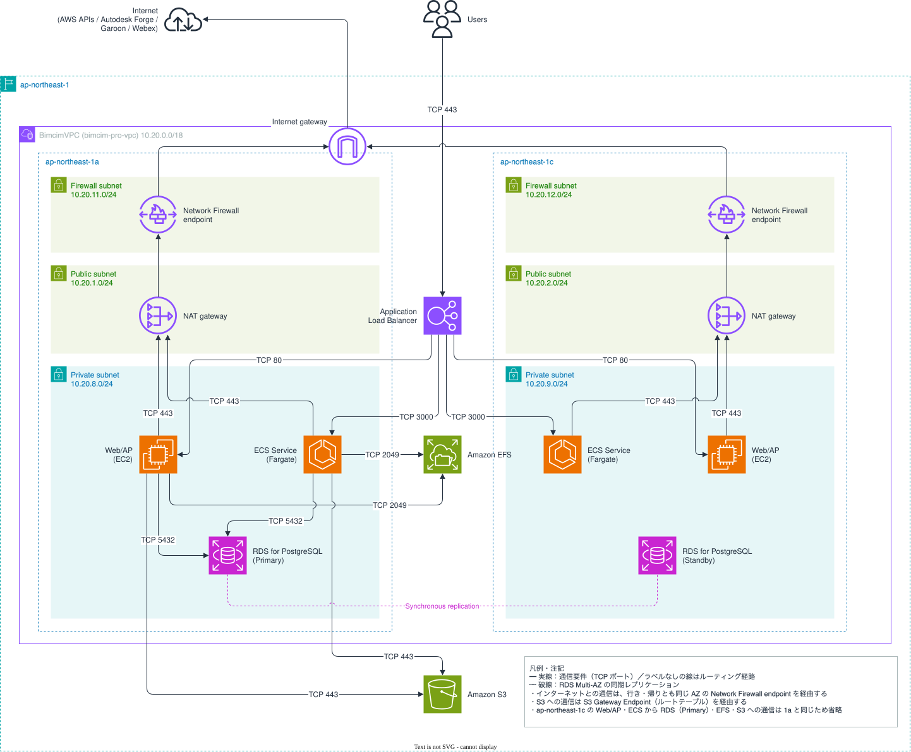

# AGENTS.md

## 1. プロジェクト概要

このリポジトリは、AWSインフラの通信要件をコードとして管理し、
Terraformによるインフラ構築と、設計ドキュメントの自動生成・AI編集を実現する
ボイラープレートです。

主な目的は以下のとおりです。

- AWSの通信要件をGitHubで一元管理する
- 通信要件をYAMLで定義する
- YAMLとTerraformの共通部分（通信要件）を照合し、ずれを検出する
- YAMLを正本として、AIがAWS構成図（draw.io）を編集する
- draw.ioからSVGを出力し、GitHub上で閲覧できるようにする
- YAMLから通信要件一覧（CSV）を生成する
- GitHub Actionsで検証と生成処理を自動化する
- Terraformと設計ドキュメントを同じリポジトリで管理する

最終的には、Pull Requestのレビュー時に
Terraformと設計ドキュメントのずれに気づける構成を目指します。

---

## 2. 技術スタック

| 用途 | 技術 |
|---|---|
| 通信要件定義 | YAML |
| YAML構文・スタイル検証 | yamllint |
| YAMLスキーマ検証 | JSON Schema |
| スキーマ検証ツール | check-jsonschema |
| インフラ構築 | Terraform |
| AWS構成図 | draw.io（diagrams.net） |
| 図の表示形式 | SVG |
| 通信要件一覧 | CSV |
| 検証・CSV生成スクリプト | Python |
| CI/CD | GitHub Actions |
| バージョン管理 | Git / GitHub |

### 使用しない技術

- TypeScript
- Valibot
- Node.jsを前提とした独自ツール

原則として、Terraform・Python・既存CLIツールを利用する。

---

## 3. 基本設計方針

### 3.1 YAMLとTerraformをそれぞれ正本とする

正本は2つあり、それぞれ管理する範囲が異なる。

| 正本 | 管理する範囲 |
|---|---|
| YAML（`specifications/communication.yaml`） | 設計ドキュメント（通信要件・構成図・CSV） |
| Terraform（`terraform/`） | インフラの実装 |

設計ドキュメント（CSV・draw.io・SVG）はYAMLから作る。

TerraformはYAMLから生成せず、手で書く。
YAMLにはUsersや外部サービスなどAWS以外の要素も含まれ、
TerraformにはYAMLにない実装の詳細が含まれるため、両者は完全には一致しない。

どちらを先に変更してもよい。

```text
Communication Requirements (YAML)          Terraform
        |                                      |
        +-- Validation                         +-- fmt / validate
        |     +-- yamllint                     |
        |     +-- JSON Schema                  |
        |                                      |
        +-- Python -> CSV                      |
        +-- AI -> draw.io -> SVG               |
        |                                      |
        +------- 共通部分を照合（3.2） ---------+
```

### 3.2 共通部分を照合する

YAMLとTerraformの両方に現れる情報だけを、双方向で照合する。

| 区分 | 内容 |
|---|---|
| YAMLのみ | Users・外部サービス、label、layout、scope、description など構成図向けの情報 |
| 共通部分（照合する） | 通信とSecurity Groupルールの対応（通信ID・protocol・port） |
| Terraformのみ | Security Group自体、ALBのlistener、ターゲットグループ、ルートテーブル、IAMなど実装の詳細 |

照合の結果はレポートとして出力し、原則としてCIを失敗させない。
ずれが見つかった場合、YAMLとTerraformのどちらを直すかは人が判断する。

報告する内容：

- 一致している通信
- protocol / port の不一致
- YAMLのみにある通信（Terraform未対応）
- Terraformのみにある通信IDなしのSecurity Groupルール（YAML未反映）

YAMLに存在しない通信IDがTerraformに書かれている場合は、
タイポや削除漏れの可能性が高いためエラーとしてよい。

Security Group以外で制御する通信（VPC Endpoint、外部SaaS、SAML / OIDCなど）や、
CIDR・リソース配置・listener・ルートなど照合対象外の要素は、
Pull Requestのレビューで確認する。

### 3.3 設計ドキュメントを管理する

通信要件YAMLを基に、以下の設計ドキュメントを管理する。

1. CSV形式の通信要件一覧（自動生成）
2. AWS公式アイコンを使用したdraw.io構成図（AIが編集）
3. GitHub上で表示するSVG（draw.ioから出力）

CSV は自動生成するため直接編集しない。draw.io 図は `docs/diagrams/AGENTS.md` の規約に従って AI が編集し、変更後に SVG を出力する。

---

## 4. ディレクトリ構成

以下は推奨構成であり、既存のディレクトリ構成がある場合はそれを優先する。

```text
.
├── AGENTS.md
├── README.md
│
├── specifications/
│   ├── communication.yaml
│   └── communication.schema.json
│
├── terraform/
│   ├── main.tf
│   ├── variables.tf
│   ├── outputs.tf
│   └── versions.tf
│
├── scripts/
│   └── generate_csv.py
│
├── docs/
│   ├── diagrams/
│   │   ├── communication.drawio
│   │   └── communication.svg
│   └── tables/
│       └── communication.csv
│
└── .github/
    └── workflows/
        └── validate.yml
```

必要に応じてディレクトリやファイルを追加してよい。

ただし、最初から過度に複雑な構成にしないこと。

---

## 5. 通信要件YAML

初期PoCでは、以下のAWS構成を対象とする。

```text
ALB
 |
 | TCP 3000
 v
ECS
 |
 | TCP 5432
 v
RDS (PostgreSQL)
```

YAMLの定義例：

```yaml
resources:
  alb:
    type: aws_alb
    label: Application Load Balancer

  ecs:
    type: aws_ecs
    label: ECS Application

  rds:
    type: aws_rds
    label: PostgreSQL

communications:
  - id: alb-to-ecs
    source: alb
    destination: ecs
    protocol: tcp
    port: 3000
    description: ALBからECSへのアプリケーション通信

  - id: ecs-to-rds
    source: ecs
    destination: rds
    protocol: tcp
    port: 5432
    description: ECSからRDSへのデータベース接続
```

### YAML設計時の注意点

- 通信要件には一意のIDを付与する
- sourceとdestinationはresourcesで定義したIDを参照する
- protocolとportを明示する
- 通信目的をdescriptionに記載する
- 必要に応じて環境情報を追加できる設計にする
- subnet を持たないリソースには、必要に応じて `scope` を指定する。`regional` は Region 内・VPC 外、`external` は Region 外を表し、省略時は `external` とする
- Terraform固有の値と論理的な通信要件を可能な限り分離する
- Security Groupは定義しない（Security Groupは通信を実現する手段であり、Terraform側で管理する）

YAMLの構造はPoCで検証しながら改善してよい。

---

## 6. YAMLバリデーション

### 6.1 yamllint

YAMLの構文およびスタイルを検証する。

### 6.2 JSON Schema

以下を検証する。

- 必須フィールド
- データ型
- protocolの許可値
- portの範囲（1〜65535）
- resourcesとcommunicationsの基本構造

### 6.3 追加の整合性チェック

JSON Schemaだけでは検証が難しい項目については、
必要に応じてPythonで検証する。

例：

- 通信IDの重複
- 未定義のsource / destination
- 不正なリソース参照

バリデーションに失敗した場合は、生成処理を中断する。

---

## 7. draw.io 編集と SVG 出力

`specifications/communication.yaml` を正本として、AI が `docs/diagrams/communication.drawio` を編集する。Python スクリプトで draw.io XML を自動生成しない。

AI は `docs/diagrams/AGENTS.md` の規約に従い、AWS4 アイコン、配色、レイアウト、通信線のスタイルを維持する。YAML にないリソースや通信を図へ追加しない。

図を更新したら、draw.io から `docs/diagrams/communication.svg` を出力する。SVG は GitHub の README から参照する。

```markdown

```

---

## 8. CSV生成

YAMLのcommunicationsからCSVを生成する。

出力イメージ：

| ID | Source | Destination | Protocol | Port | Description |
|---|---|---|---|---|---|
| alb-to-ecs | alb | ecs | tcp | 3000 | ALBからECSへの通信 |
| ecs-to-rds | ecs | rds | tcp | 5432 | ECSからRDSへの通信 |

CSVはYAMLから自動生成する。

手動での編集は行わない。

---

## 9. Terraform

### 基本方針

- TerraformはYAMLから生成せず、手で書く（YAMLを `yamldecode()` で読み込まない）
- YAMLとの照合（3.2）ができるよう、以下の記述ルールに従う
- Terraformの変更内容はplanで確認する

### YAMLとの照合のための記述ルール

YAMLのリソース1つにつき、Security Groupを1つ作る。
Security Groupのリソース名はYAMLのリソースIDに合わせる（`-` は `_` に置き換える）。

| YAML | Terraform |
|---|---|
| `resources.alb` | `aws_security_group.alb` |
| `resources.batch-worker`（例） | `aws_security_group.batch_worker` |

Security Groupルールは `aws_vpc_security_group_ingress_rule` / `aws_vpc_security_group_egress_rule` で1ルールずつ書く。
`aws_security_group` の中に `ingress {}` / `egress {}` を書かない。

YAMLの通信に対応するルールには、通信IDを `CommunicationId` タグで記載する。
1つの通信は、宛先側のingressと送信元側のegressの2ルールに対応する。

```hcl
resource "aws_vpc_security_group_ingress_rule" "ecs_from_alb" {
  security_group_id            = aws_security_group.ecs.id
  referenced_security_group_id = aws_security_group.alb.id
  ip_protocol                  = "tcp"
  from_port                    = 3000
  to_port                      = 3000

  tags = {
    CommunicationId = "alb-to-ecs"
  }
}
```

Security Groupを持たない相手（`users`、`aws-services` などVPC外のリソース）は、
`cidr_ipv4` で表す。

### 注意点

- すべての通信をSecurity Groupルールに変換しない
- ingress / egressの方向を正しく扱う
- 必要以上に広いCIDRを許可しない
- Security Group間参照を優先的に検討する
- Terraformの差分が意図しないリソース削除を引き起こさないようにする

初期PoCでは、実際のAWS環境へのデプロイを必須としない。

---

## 10. GitHub Actions

Pull Request時に以下を実行する。

1. yamllint
2. JSON Schema検証
3. 追加の整合性チェック
4. CSV生成
5. Terraform fmt
6. Terraform validate
7. YAMLとTerraformの照合レポート（3.2。原則としてCIを失敗させない）

生成物をGitで管理する場合は、
生成前後に差分がないことも検証する。

Terraform planは、AWS認証情報や対象環境が整備された段階で追加する。

GitHub ActionsからAWSへアクセスする場合は、
長期アクセスキーではなくOIDCによる認証を優先する。

---

## 11. 実装順序

以下の順序で実装する。

### Phase 1：通信要件の定義

- communication.yamlを作成
- JSON Schemaを作成
- yamllintを導入
- YAMLの検証を実装

### Phase 2：ドキュメント生成

- YAMLからCSVを生成
- YAMLを正本としてAIがdraw.ioを編集
- draw.ioからSVGを出力
- READMEにSVGを表示

### Phase 3：Terraform連携

- 記述ルール（9章）に従ってSecurity Groupを手で書く
- YAMLとTerraformの照合スクリプトを作成する
- Terraform fmt / validateを実行
- Terraform planで変更内容を確認

### Phase 4：CI/CD

- GitHub Actionsを導入
- PR時にYAMLを検証
- ドキュメント生成を検証
- Terraformの静的検証を実行

---

## 12. Codexへの作業指示

このリポジトリで作業するAIエージェントは、以下のルールに従うこと。

### 実装前

1. 既存のディレクトリ構成を確認する
2. 既存ファイルの内容を確認する
3. 必要な変更内容を整理する
4. 既存の設計方針との整合性を確認する

### 実装時

- TypeScriptを使用しない
- 必要以上に依存ライブラリを増やさない
- Pythonは標準ライブラリを優先する
- YAMLを設計ドキュメントの正本、Terraformをインフラの正本として扱う
- 図に記載する通信要件をYAMLと一致させる
- Security Groupルールを変更した場合は、YAMLのcommunicationsへの反映要否を確認する
- YAMLのcommunicationsを変更した場合は、Terraformへの反映要否を確認する
- スクリプトはローカルでも実行可能にする
- シンプルで理解しやすい実装を優先する

### 検証時

- YAMLのバリデーションを実行する
- 生成したCSVの内容を確認する
- draw.ioファイルが開けることを確認する
- SVGでAWSアイコンが表示されることを確認する
- Terraform fmt / validateを実行する

### 禁止事項

- ユーザーの許可なくAWSリソースを作成・変更・削除しない
- ユーザーの許可なくTerraform applyを実行しない
- AWS認証情報やシークレットをリポジトリに保存しない
- 既存ファイルを理由なく削除しない
- YAMLからTerraformを生成しない（TerraformでYAMLを読み込まない）

---

## 13. 最初のゴール

初期PoCの完成条件は以下とする。

- ALB → ECS → RDSの通信要件がYAMLで定義されている
- YAMLの構文とスキーマが検証できる
- YAMLからCSVが生成できる
- YAMLと整合するAWSアイコン付きdraw.ioをAIが編集できる
- draw.ioからSVGを出力できる
- GitHub上でSVGを表示できる
- 記述ルールに従ったTerraformでSecurity Groupが定義されている
- YAMLとTerraformの照合レポートを出力できる
- Terraformの静的検証が成功する

まずは小さく動作する構成を完成させ、
その後に複数環境や複雑なAWS構成への対応を進める。
