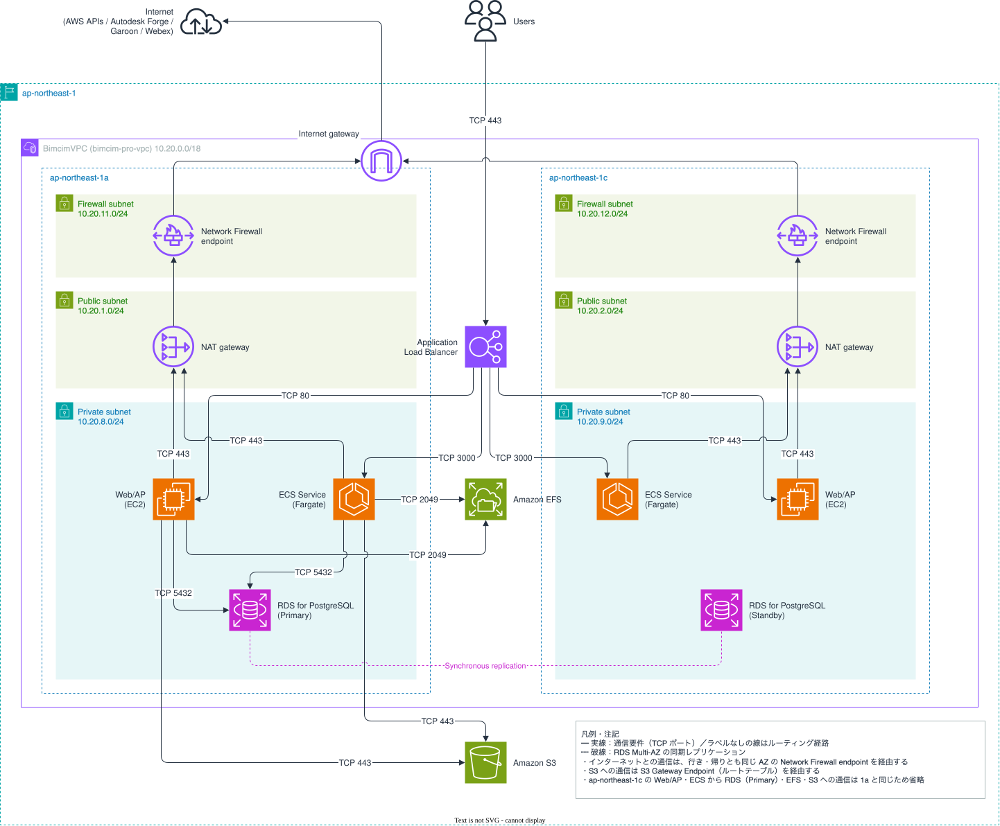

# terraform-docs-boilerplate

AWS の通信要件を YAML で管理し、Terraform と設計ドキュメント（CSV・draw.io・SVG）を同一リポジトリで管理するためのボイラープレート。

## 通信構成図

`specifications/communication.yaml` を正本として、AI が `docs/diagrams/communication.drawio` を編集する。編集規約は [docs/diagrams/AGENTS.md](docs/diagrams/AGENTS.md) を参照する。



## 通信要件一覧

`specifications/communication.yaml` から自動生成している。CSV 版：[docs/tables/communication.csv](docs/tables/communication.csv)

<!-- BEGIN: communication-table (自動生成のため直接編集しない) -->
| ID | Source | Destination | Via | Protocol | Port | Description |
|---|---|---|---|---|---|---|
| users-to-alb | users | alb |  | tcp | 443 | 利用者からALBへのHTTPS通信（Network Firewall経由） |
| alb-to-web-ap | alb | web-ap |  | tcp | 80 | ALBからWeb/APサーバーへのHTTP通信 |
| alb-to-ecs | alb | ecs |  | tcp | 3000 | ALBからECSへのアプリケーション通信 |
| web-ap-to-rds | web-ap | rds |  | tcp | 5432 | Web/APサーバーからRDSへのデータベース接続 |
| ecs-to-rds | ecs | rds |  | tcp | 5432 | ECSからRDSへのデータベース接続 |
| web-ap-to-efs | web-ap | efs |  | tcp | 2049 | Web/APサーバーからEFSへのNFS接続 |
| ecs-to-efs | ecs | efs |  | tcp | 2049 | ECSからEFSへのNFS接続 |
| web-ap-to-internet | web-ap | internet | nat | tcp | 443 | Web/APサーバーからNAT Gateway・Network Firewall経由でSystems Manager・Garoon・WebexへのHTTPS通信 |
| ecs-to-internet | ecs | internet | nat | tcp | 443 | ECSからNAT Gateway・Network Firewall経由でECR・CloudWatch Logs・Autodesk ForgeへのHTTPS通信 |
| web-ap-to-s3 | web-ap | s3 |  | tcp | 443 | Web/APサーバーからS3 Gateway Endpoint経由でS3へのHTTPS通信 |
| ecs-to-s3 | ecs | s3 |  | tcp | 443 | ECSからS3 Gateway Endpoint経由でS3へのHTTPS通信（ECRイメージレイヤー取得を含む） |
<!-- END: communication-table -->

## ディレクトリ構成

```
terraform-docs-boilerplate
├── specifications/ # 通信要件 YAML（正本）と JSON Schema
├── terraform/      # Terraform コード
├── scripts/        # 検証・生成用 Python スクリプト
├── docs/           # 設計書・運用手順書
│   ├── diagrams/   # 構成図（AI が YAML を基に編集）
│   └── tables/     # 通信要件一覧 CSV（自動生成）
└── .github/        # GitHub Actions・PR テンプレート
```

詳細な方針は [AGENTS.md](AGENTS.md)、開発環境は [docs/README.md](docs/README.md) を参照。
